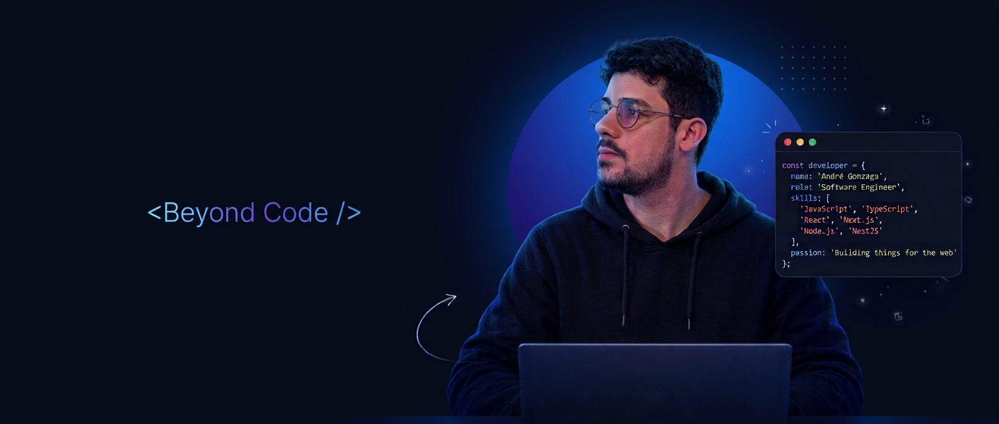
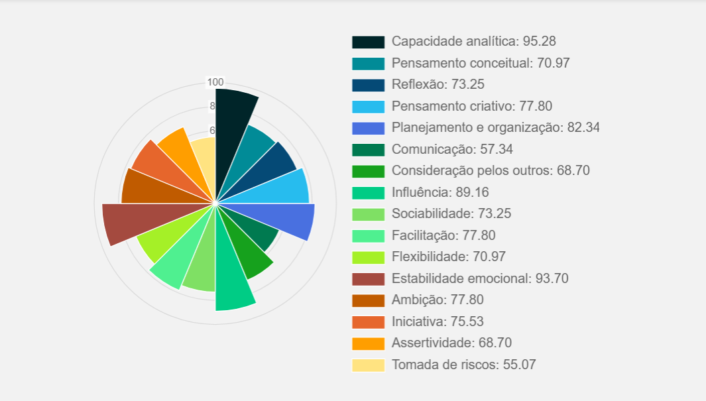

<!--  -->

<h2 align="center">💻 Hard Skills</h2>

<table>
  <tr>
    <td align="center" width="50%">
      <h3>🎨 Frontend Development</h3>

      

        
      

      

        
      

      Desenvolvimento de interfaces e aplicações web modernas.
    </td>

    <td align="center" width="50%">
      <h3>⚙️ Backend Development</h3>

      

        
      

      APIs, serviços, regras de negócio e integrações.

        

      <strong>REST APIs · GraphQL · Prisma ORM · TypeORM · JWT · Axios</strong>
    </td>
  </tr>

  <tr>
    <td align="center" width="50%">
      <h3>🗄️ Database & Data Engineering</h3>

      

        
      

      

        
      

      

        
      

      Modelagem, persistência, consultas e processamento de dados.

        

      <strong>SQL · PL/SQL</strong>
    </td>

    <td align="center" width="50%">
      <h3>🏗️ Software Engineering & Architecture</h3>

       

      <strong>DDD · SOLID · Clean Code · Design Patterns</strong>

        

      <strong>Clean Architecture · Modular Architecture</strong>

        

      Estruturação, modelagem de domínio, qualidade e manutenibilidade de software.
    </td>
  </tr>

  <tr>
    <td align="center" width="50%">
      <h3>🧪 Testing & Quality</h3>

      

        
        
      

      

        <strong>Vitest · React Testing Library</strong>
      

      Testes automatizados, validação e qualidade de software.
    </td>

    <td align="center" width="50%">
      <h3>☁️ DevOps & Cloud</h3>

      

        
      

      

        
      

      Containerização, versionamento, pipelines e infraestrutura cloud.

        

      <strong>CI/CD · S3 · CodeBuild · CodePipeline · Elastic Beanstalk</strong>
    </td>
  </tr>
</table>

 

## 🧠 Mindset · Teste de Perfil

  Minha última avaliação de perfil e características comportamentais.

## 👋🏻 Sobre mim

Olá! Eu sou o André Gonzaga.

👨‍💻 Engenheiro de Software Full Stack com experiência em desenvolvimento de aplicações, APIs, integrações, bancos de dados e migração de dados, atuando com JavaScript, TypeScript, React, Next.js, Node.js, NestJS e Oracle/PLSQL.

🏗️ Interesse em Arquitetura de Software e Engenharia de Software, com foco na construção de soluções organizadas, escaláveis, manuteníveis e testáveis.

🌱 Atualmente aprofundando conhecimentos em Arquitetura de Software, Cloud, DevOps e tecnologias modernas de desenvolvimento.

🖥️ Disponho de equipamento próprio, ambiente profissional adequado e infraestrutura preparada para atuação em regime remoto.

 

## 🛠️ Tecnologias & Ferramentas

- **Linguagens:** JavaScript, TypeScript, SQL, PL/SQL
- **Frontend:** React, Next.js, HTML5, CSS3, Tailwind CSS, Styled Components, Material ui
- **Backend:** Node.js, NestJS, Express, REST APIs, GraphQL, Prisma ORM, TypeORM, JWT, Axios
- **Arquitetura & Engenharia de Software:** DDD, SOLID, Clean Code, Design Patterns, Clean Architecture, Modular Architecture
- **Bancos de Dados:** Oracle, PostgreSQL, MySQL, MongoDB, Redis
- **APIs & Documentação:** REST, GraphQL, OpenAPI
- **Testes & Qualidade:** Jest, Vitest, Playwright, Cypress, React Testing Library
- **Cloud & DevOps:** AWS, S3, Elastic Beanstalk, CodeBuild, CodePipeline, Docker, Git, GitHub, CI/CD
- **Design & Prototipação:** Figma, Adobe Photoshop, Adobe Illustrator, Adobe XD
- **Metodologias & Práticas:** Scrum, Kanban, metodologias ágeis, colaboração e trabalho em equipe
- **IA aplicada ao desenvolvimento:** IA Generativa, Prompt Engineering

 

## 💼 Projetos & Portfólio

Desenvolvo projetos práticos voltados à Engenharia de Software, desenvolvimento Full Stack, Arquitetura, integração de APIs, bancos de dados e qualidade de software.

🔗 **[Acesse meu portfólio](https://portfoliobyandreg.vercel.app/)**

Conheça meus projetos, tecnologias utilizadas, decisões técnicas e aplicações desenvolvidas.

📄 **[Acesse meu currículo](https://templateforcurriculumbyandregonzaga.netlify.app/)**

 

## ✨ Como eu trabalho

- Código limpo, manutenível e testável
- Boas práticas de Engenharia de Software e arquitetura
- Comunicação, colaboração e foco na resolução de problemas

 

## 📫 Contato

* 📄 **Currículo:** [André Luiz Soares Gonzaga](https://templateforcurriculumbyandregonzaga.netlify.app)
* 💼 **LinkedIn:** [linkedin.com/in/andregonzaga95](https://www.linkedin.com/in/andregonzaga95)
* 📧 **E-mail:** [andregonzaga95@gmail.com](mailto:andregonzaga95@gmail.com)
* 💬 **WhatsApp:** [+55 (82) 98707-7520](https://wa.me/5582987077520)

